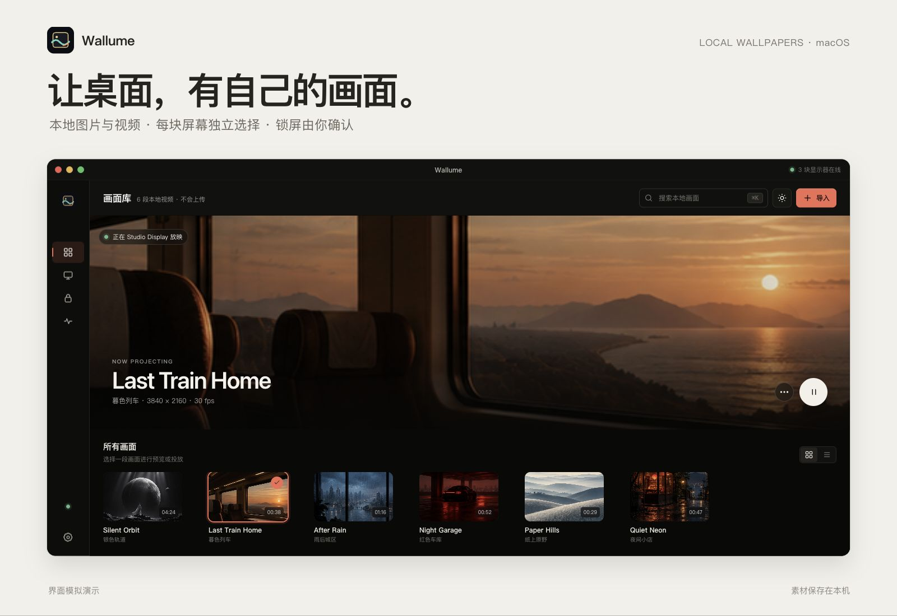
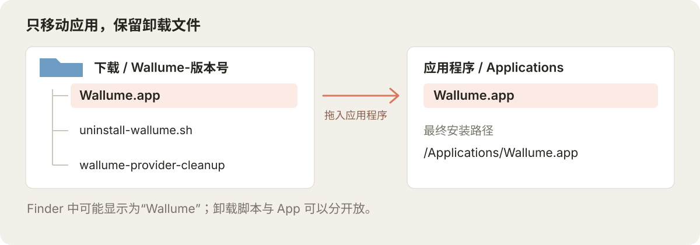
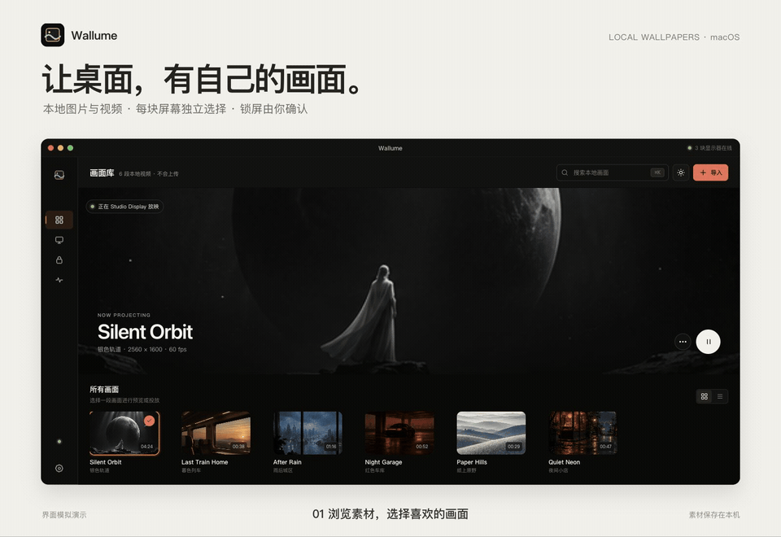

<p align="center">
  
</p>

<h1 align="center">Wallume</h1>

<p align="center"><strong>把喜欢的本地画面，放到每一块屏幕上。</strong></p>

<p align="center">
  
  
  
</p>

<p align="center">
  <a href="https://github.com/floki-u/Wallume/releases">下载</a> ·
  <a href="#下载与安装">安装</a> ·
  <a href="#开始使用">使用</a> ·
  <a href="#停用与卸载">卸载</a> ·
  <a href="CHANGELOG.md">更新记录</a>
</p>



Wallume 是一款 macOS 本地墙纸工具：导入自己的图片或视频，为内建屏和外接屏分别选择画面。在 macOS 26 及以上版本（包括 macOS 27）上，还可以将视频交给系统，用作原生桌面与锁屏动态墙纸。

素材保存在本机，不上传图片或视频。原生墙纸与锁屏由你在“系统设置 → 墙纸”中最后确认。

> **当前为实验版。** 多显示器、睡眠唤醒和锁屏切换仍在验证中；不同系统与视频编码的表现可能不同，请保留原始素材。

<details>
<summary>查看应用界面截图</summary>


</details>

## 功能与兼容性

| 功能 | 可以做什么 |
| --- | --- |
| 本地画面库 | 导入 PNG、JPG/JPEG、HEIC、MOV、MP4，也可以导入素材文件夹。 |
| 多显示器分配 | 为内建屏和外接屏分别选择图片或视频。 |
| 图片与视频墙纸 | 图片直接显示原始资源；视频在应用运行期间播放。 |
| 原生锁屏动态墙纸 | macOS 26 及以上版本上准备系统专用副本，由你在系统设置中选择并确认。 |
| 本地数据管理 | 分别清理预览缓存、诊断记录和原生墙纸副本。 |

| 环境 | 支持情况 |
| --- | --- |
| macOS 14 / 15 | 本地素材导入、显示器分配与桌面墙纸；不提供原生墙纸提供者功能。 |
| macOS 26 及以上（包括 macOS 27） | 支持上述功能，并提供实验性的原生桌面与锁屏动态墙纸；26 及后续版本共用同一套兼容逻辑。 |
| Apple Silicon | 当前 1.3.0 下载包为 `arm64`，适用于 M 系列芯片的 Mac。 |
| Intel Mac | 当前下载包不包含 Intel 原生版本。 |

原生动态墙纸通过系统私有接口实现。代码按 macOS 26 及以上版本兼容，macOS 27 的实机验证尚未完成；具体表现取决于对应系统版本的接口与运行环境。

## 下载与安装

### 1. 下载并解压

打开 [Releases](https://github.com/floki-u/Wallume/releases)，下载最新 **Pre-release** 的 `Wallume-版本号.zip`。选择发布页 **Assets** 中的应用压缩包，`Source code (zip)` 是源码。

**先双击 ZIP 解压。** 解压后会得到 `Wallume-版本号` 文件夹；如果归档实用工具一直停在“正在解压缩”，请使用下方的备用方法。

<details>
<summary>解压卡住了：使用终端解压</summary>

先取消当前解压；若无法取消，在“活动监视器”中退出“归档实用工具”。将半成品文件夹移到废纸篓，再打开“终端”运行：

```bash
cd ~/Downloads
ditto -x -k "Wallume-1.3.0.zip" .
```

这里以 1.3.0 为例，其他版本请替换 ZIP 文件名。压缩包自带版本文件夹，无需提前创建目录。命令解压是备用方式，双击卡住的具体原因需要结合当时的系统状态排查。

</details>

### 2. 安装应用

打开解压后的文件夹，**只将带应用图标的“Wallume”拖到“应用程序”**。它的完整文件名是 `Wallume.app`，Finder 通常会隐藏 `.app` 后缀。



安装后的应用路径应为 `/Applications/Wallume.app`。不要把整个 `Wallume-版本号` 文件夹拖进去，否则后文的默认安装路径就对不上了。

| 解压后的文件 | 放在哪里 |
| --- | --- |
| `Wallume.app` | 拖到“应用程序”。 |
| `uninstall-wallume.sh` | 留在下载目录的版本文件夹，或移到你会保留的位置。 |
| `wallume-provider-cleanup` | 建议与卸载脚本放在一起，卸载时用于清理原生墙纸资源。 |

**App 和卸载脚本可以分开放。** 从 1.3.0 起，脚本会优先使用旁边的独立清理工具；找不到时，也能使用指定 App 内的工具。同一磁盘中拖动 App 后，它从原文件夹消失是正常现象。

### 3. 首次打开

在“应用程序”中双击 Wallume。当前实验包采用开发签名，尚未经过 Apple 公证；如果 macOS 拦截打开，确认压缩包来自本项目 Releases 后，在“终端”运行：

```bash
xattr -dr com.apple.quarantine /Applications/Wallume.app
open /Applications/Wallume.app
```

## 开始使用



*上方展示图与动图为基于项目界面制作的模拟演示，展示素材仅用于说明；实际界面和播放效果以应用为准。*

[查看高清演示（MP4）](docs/images/wallume-demo.mp4)

### 为桌面选择画面

1. 打开“画面库”，导入本地图片、视频或素材文件夹。
2. 到“显示器”，为每块屏幕选择想要的画面。
3. 查看桌面效果。视频墙纸需要 Wallume 保持运行；拔插显示器或睡眠唤醒后，可检查各屏是否恢复正常。

### 为锁屏选择动态画面 · macOS 26 及以上

1. 先在“显示器”中为主显示器选择一段视频。
2. 打开“锁屏同步”，点击“用于锁屏”，等待素材准备完成。
3. 在“系统设置 → 墙纸”的 **Wallume** 分组中选择刚准备的画面。
4. 回到 Wallume，点击“我已选择，重新检查”。系统确认实际选择后，应用才会显示“锁屏已启用”。

“已准备”表示素材副本已创建，**还需要完成系统选择**。如果要用静态图片作为系统墙纸或锁屏，请在系统墙纸设置中手动选择该图片。

### 切换或清理锁屏素材

1. 先在“系统设置 → 墙纸”中选择非 Wallume 墙纸。
2. 回到“锁屏同步 → 管理锁屏资源”，点击“检查系统状态”。
3. 确认可以清理后，再清理锁屏副本，随后准备新素材或删除旧素材。

## 停用与卸载

**先切换系统墙纸，再运行脚本，最后删除 App。** 卸载脚本执行期间，`Wallume.app` 必须仍然存在。

下面假设 App 位于 `/Applications/Wallume.app`，卸载文件保存在 `~/Downloads/Wallume-1.3.0/`。版本或存放位置不同，请替换命令中的对应路径；路径中有空格时保留引号。

### 停用并清理原生墙纸副本，保留素材库

在“系统设置 → 墙纸”中选择非 Wallume 墙纸，然后运行：

```bash
bash "$HOME/Downloads/Wallume-1.3.0/uninstall-wallume.sh" "/Applications/Wallume.app"
```

按提示确认后，脚本会退出应用、注销原生墙纸扩展并清理提供者副本。已导入的素材库、缓存和设置会保留，方便之后继续使用。

### 完整卸载

在“系统设置 → 墙纸”中选择非 Wallume 墙纸，然后运行：

```bash
bash "$HOME/Downloads/Wallume-1.3.0/uninstall-wallume.sh" --purge-data "/Applications/Wallume.app"
```

1. 按提示确认系统已切换到非 Wallume 墙纸。
2. 输入 `DELETE`，将 Wallume 的素材库、缓存、诊断和偏好移到废纸篓，并清理提供者副本与偏好。
3. 等待脚本完成，再把“应用程序”中的 Wallume 移到废纸篓。

外部位置的原始图片和视频不会删除。macOS 可能留下不含用户数据的空沙盒容器元数据，这是系统管理记录。

## 常见问题

<details>
<summary>已经把整个版本文件夹拖进“应用程序”了，怎么办？</summary>

打开该文件夹，把里面的“Wallume”移动到“应用程序”根目录，得到 `/Applications/Wallume.app`。另外两个卸载文件可以继续留在原文件夹；卸载时使用脚本的实际路径即可。

</details>

<details>
<summary>下载文件夹或卸载脚本被删了，还能卸载吗？</summary>

可以重新下载并解压完整安装包，保留其中的卸载脚本和配套清理工具。运行新下载的脚本时，传入已安装 App 的实际路径即可。请先运行脚本，再删除 App。

</details>

<details>
<summary>切换了系统墙纸，为什么仍显示不能清理？</summary>

macOS 可能在锁屏、设置页面切换或唤醒后延迟释放墙纸资源。等待数秒，再点击“检查系统状态”；应用确认可以清理后再操作。

</details>

<details>
<summary>可以直接把 App 拖到废纸篓吗？</summary>

拖入废纸篓不会执行 Wallume 的清理逻辑，可能留下原生墙纸扩展和提供者资源。请按上方顺序完成卸载。

</details>

<details>
<summary>遇到导入、显示器或锁屏问题，如何反馈？</summary>

在 [Issues](https://github.com/floki-u/Wallume/issues) 中说明 macOS 版本、芯片类型、显示器数量、素材格式和复现步骤。若与拔插显示器、睡眠唤醒或锁屏有关，也请注明；可在“设置 → 本地数据”导出匿名诊断摘要。请勿附上私人图片或视频。

</details>

## 项目资料与使用许可

普通用户下载发布包即可。需要查看实现或本地构建时，可参考 [Package.swift](Package.swift) 与 [构建脚本](build-app.sh)；构建应用需要 Xcode 和匹配的 Apple Development 签名身份，脚本通过 `WALLUME_DEVELOPMENT_TEAM` 接收开发团队 ID。

Wallume **不是开源软件**，且仅允许个人学习、体验与非商业测试。未经著作权人书面许可，不得将本项目的源码、应用、图标或任何衍生版本用于商业用途、销售、再分发或作为其他产品的一部分。

第三方组件的来源与授权见 [Third-party notice](NativeWallpaperProvider/NOTICE.md)。
